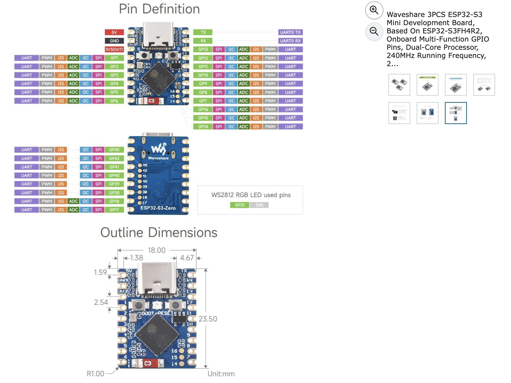
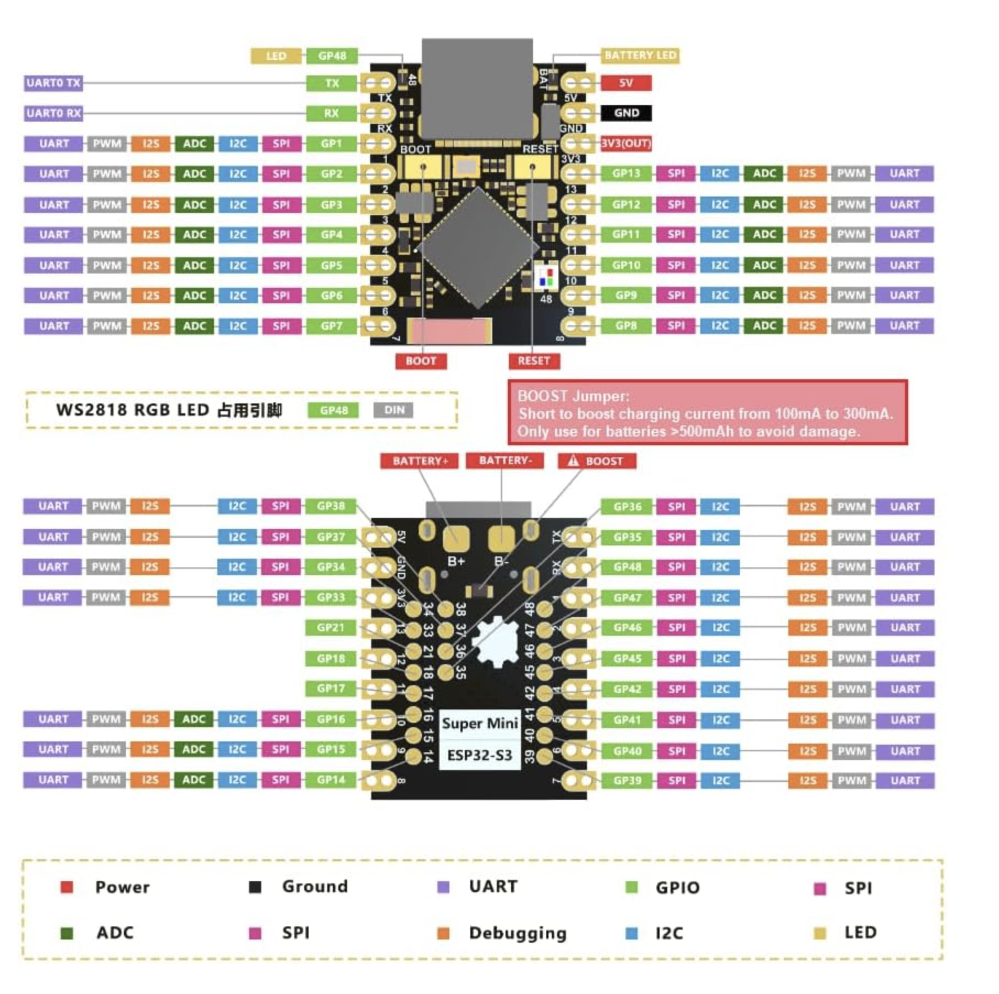

# povd-hub — rotor hub board

Status: rev A routed (84 x 70 mm, 4 layers), DRC clean apart from library-link warnings, ERC no errors; 12-40 V input parts fitted. Next: final Gerbers, drill and CPL, then the JLC order.

## 1. Requirements

| Item | Value |
|---|---|
| Input | 12–40 V (24 V or 36 V nominal) through the slip ring, 4 x (4 x 5 mm) brushes, 2 per polarity in parallel. Absolute limit set by the LM74700 (65 V) and the SMCJ40A clamp (64.5 V max) |
| LED outputs | 8 channels for clocked strips (APA102 / SK9822 class), 65 LEDs per strip. Start with 2 or 4 strips fitted; the board carries all 8 channels |
| 5 V LED rail | 15 A continuous. Covers 4 strips at full white, or 8 strips with the firmware current limit |
| LED data | 8 independent data lines, 8 buffered clock copies, >= 20 MHz |
| Encoder | 2 inputs (A, B) with pull-ups, Schmitt-buffered |
| Processor | Waveshare ESP32-S3-Zero stacked on 2 x 9 pin headers at the centre of the board. On-board ceramic antenna, no external antenna |
| Mounting | Square board centred on the rotor axis, on standoffs on top of the hub |
| Connectors | No wire pads. Blade harnesses, power and encoder all on latching or keyed connectors (section 7) |
| Assembly | JLC, SMT parts on both sides (caps on the bottom). J1 (XT30), the S3-Zero headers and the S3-Zero are fitted by hand |

## 2. Power budget

| Strips fitted | LEDs | All full white | Typical image (~25–35 % average) |
|---|---|---|---|
| 2 | 130 | 7.8 A | 2–3 A |
| 4 | 260 | 15.6 A | 4–5.5 A |
| 8 | 520 | 31.2 A | 8–11 A |

| Quantity at the 15 A rating | Value |
|---|---|
| 5 V output | 75 W |
| Efficiency (24 V -> 5 V, ~400 kHz) | ~93 % (somewhat lower at 40 V: switching loss scales with VIN) |
| Input power | 81 W |
| Input current at 24 V / at 22 V after brush drop / at 40 V | 3.4 A / 3.7 A / ~2.1 A |
| Current per brush (2 per polarity) | ~1.7–1.9 A |
| Heat on the board | ~6 W |

Firmware reads the input current and scales global brightness so the 5 V load stays under the rating. Fast column-to-column load steps still occur at any average current; the low-ESR output capacitance covers them.

## 3. Block diagram

```
 brushes 24V ──► J1 XT30 ──► fuse ──► ideal diode (reverse polarity) ──► TVS + input caps ──┬──► LM5145 buck ──► +5V (15 A)
                                                                                 │       ▲ EN (MCU, default off)
                                                                                 │       └─ PGOOD ──► test point
                                                                                 ├──► shunt + INA240 ──► MCU ADC
                                                                                 └──► LMR51610 ───► Schottky ──► +5V_LOGIC ──► S3-Zero 5V pad
                                                                                                                   (S3-Zero LDO makes 3V3)

 S3-Zero LCD_CAM i80: D0..D7 ──► 74AHCT245 #1 ──► 33R ──► DAT1..DAT8
                      PCLK   ──► 74AHCT245 #2 (all 8 inputs tied) ──► 33R ──► CLK1..CLK8
                      OE (pull-up = outputs off at boot)

 J4/J6 encoder (GH, in parallel) ──► pull-up ──► RC ──► 74LVC1G17 ──► MCU (PCNT + timer capture)
```

## 4. Part selection (draft)

| Function | Part | Notes |
|---|---|---|
| Power connector | Amass XT30UPB-M on the board (vertical, through-hole), XT30 female on the brush-assembly lead | 15 A continuous |
| Input fuse | Littelfuse 0451007 (Nano2, 7 A) | ~2x the full-rating input current |
| Reverse polarity | LM74700-Q1 + BSC040N08NS5 (80 V, 4.0 mΩ) | A reversed supply does not reach the board |
| Input TVS | SMCJ40A (40 V standoff, 44.4 V breakdown min, 64.5 V clamp max) | Brush-bounce spikes. Every part on the input rail is rated >= 65 V; FETs 80/100 V, caps 63/100 V |
| Input caps | 1 uF 100 V 0805 + 4 x 10 uF 100 V X7S 1210 at the FETs, 4.7 uF 100 V 1210, 47 uF 63 V electrolytic bulk (Chemi-Con EMVE630ARA470MHA0G; EEH-ZA1J470P hybrid polymer if available) | The 10 uF MLCCs carry the switching ripple; the electrolytic's ESR damps the input lead inductance |
| 5 V converter | TI LM5145 (75 V synchronous buck controller), single phase | LCSC C485912 (LM5145RGYR) |
| Power FETs | High side CSD19533Q5A (100 V, 9.4 mΩ max, Qg 27 nC, Qgd 4.9 nC; SON 5x6 on the TDSON-8 land); low side BSC040N08NS5 (80 V, 4.0 mΩ max, Qrr 43 nC) | Chosen for gate charge and reverse recovery. The LM5145 VCC LDO is limited to 40 mA min; total Qg at 7.5 V is 54 nC → 25 mA at 400 kHz (the BSC028N06LS3 pair needed 83 mA). NexFET 80–100 V parts have high Qrr (CSD19533Q5A: 163 nC at 50 V); on the low side that is Qrr × VIN × fsw ≈ 2.6 W at 40 V per 163 nC, against 0.7 W for the BSC040N08NS5 |
| Inductor | 2.2 uH, Isat >= 26 A, 13 mm molded (Würth WE-HCI 1365 footprint). Bourns SRP1270-2R2M: Isat 40 A, 4.2 mΩ, 13.7 mm max body, 7.0 mm tall. The 1365-size Würth HCI parts top out at 22 A Isat | 4.5 A p-p ripple at 24 V in, 5.0 A at 40 V, 400 kHz |
| 5 V bulk | 4 x 470 uF 6.3 V polymer (7343-31) + 6 x 22 uF X7R 1210 | |
| Per-connector caps | 2 x 220 uF polymer + 4 x 10 uF X7R at each blade connector | |
| Logic supply | LMR51610X (65 V, 1 A, 400 kHz, VREF 0.8 V) set to 5.31 V (95.3k / 16.9k), 8.2 uH (Würth 78438357082 WE-MAIA 4030, same land as the XAL4040 footprint; or Coilcraft XAL4040-822MEC), B5819W Schottky to the S3-Zero 5V pad | The S3-Zero runs with the LED rail off. The Schottky stops USB VBUS from back-feeding the regulator |
| Input current sense | 5 mΩ 2512 shunt + INA240A3 (100 V/V) | 0.5 V/A: 1.7 V out at 3.4 A, ADC full scale (~3.1 V) at ~6 A |
| MCU | Waveshare ESP32-S3-Zero (ESP32-S3FH4R2: 4 MB flash, 2 MB PSRAM) on 2 x 1x9 2.54 mm headers | 23.5 x 18 mm, only the 18 edge pins are used. Footprint povd:Waveshare_ESP32-S3-Zero_Header (through-hole; the castellations can also be soldered straight to it) |
| LED buffers | 2 x 74AHCT245PW (TSSOP-20), Vcc = +5V | Unpowered until the LED rail is on; inputs tolerate 3.3 V with Vcc off |
| Encoder buffers | 2 x 74LVC1G17 at 3V3 | Inputs tolerate 5 V |

## 5. Encoder inputs

- J4 and J6 (JST GH 4-pin), identical and wired in parallel: SENSOR_PWR, ENC_A, ENC_B, GND. A 4-wire quadrature encoder plugs into either one. Two 3-wire sensors (power, signal, GND) each get their own connector: sensor A's signal on pin 2 of one, sensor B's signal on pin 3 of the other.
- SENSOR_PWR by solder jumper JP1: +5V_LOGIC or 3V3 (default +5V_LOGIC).
- Pull-ups: 4.7 kΩ 0603 on ENC_A and ENC_B (R36, R38) to the rail selected by JP2 (default 3V3). Change the value to suit the sensor.
- Filter: 1 kΩ series, 1 nF to GND (1 us). Edge spacing is 194 us at 2500 rpm.
- Schmitt: 74LVC1G17 at 3V3, then to GPIO.
- ESD: PESD5V0S1BL on each input.

Decode: 31 posts, 124 edges and 120 net counts per revolution, index from the high pulse ~3x longer than the others. At 188.4375 deg sensor spacing the count runs negative; swap A/B in firmware.

## 6. ESP32-S3-Zero pin map



Footprint per the Waveshare drawing: 18.00 x 23.50 mm, rows 15.24 mm apart (pin centres 1.38 mm in from each long edge), first pin 1.59 mm from the USB end, 2.54 mm pitch. Right edge from the USB end: TX, RX, IO13 ... IO7.

Only the 18 edge pins are used (5V, GND, 3V3, GPIO1–13, TX/43, RX/44). The bottom pads are not connected. The module stacks on pin headers.

| GPIO | Net | Function |
|---|---|---|
| 1 | I_IN | INA240 output (ADC1_CH0), 0.5 V/A |
| 2 | ENC_B | PCNT + capture |
| 3 | ENC_A | PCNT + capture (strapping pin; only read when the JTAG-select eFuse is burned) |
| 4 | BUCK_EN | LM5145 EN through 10k, 100k pull-down (LED rail off until firmware enables it) |
| 5 | LCD_PCLK | i80 write clock -> CLK1..CLK8 |
| 6–13 | LCD_D0..D7 | i80 data -> DAT1..DAT8 |
| 43 (U0TXD) | OPT_TX | Optical link LED driver (Q4). The ROM boot log also appears here |
| 44 (U0RXD) | OPT_RX | Optical link receiver (U10 output) |

The 24 V voltage divider was removed to free IO2; input current is still measured. The LED buffers' /OE is tied low: they are unpowered until BUCK_EN, and firmware configures LCD_CAM before enabling the rail. BUCK_PGOOD goes to a pull-up and test point only.

## 6a. Optical link (J5)

A wired IR LED and light sensor, mounted where you place them (for example on the axis, facing a matching pair on the frame), give a UART link across the rotating joint.

| J5 pin | Net | Function |
|---|---|---|
| 1 | OPT_LED_A | LED anode, fed from +5V_LOGIC through R40 (47 Ω, ~75 mA with a 1.4 V IR LED; change for the LED used) |
| 2 | OPT_LED_K | LED cathode, switched low by Q4 (AO3400A) from OPT_TX through R41, R42 gate pull-down |
| 3 | SENSOR_PWR | Sensor supply, shared with J4 and selected by JP1 |
| 4 | OPT_RX_IN | Sensor output: R43 1k load to the JP2 rail (DNP for a push-pull photo IC), ESD diode, 100 Ω + optional 100 pF, 74LVC1G17 Schmitt -> OPT_RX |
| 5 | GND | |

Set UART TX inversion in firmware so the LED is off while the line idles. Speed depends on the sensor: a phototransistor with a 1k load is good to roughly 100–250 kbit/s; a PIN photodiode or fast photo IC goes higher.


## 6b. Alternative module: ESP32-S3 Super Mini



The ESP32-S3 Super Mini (same ESP32-S3FH4R2 chip) is not pin-compatible with the S3-Zero footprint used here. Top view, USB-C at top:

- Left edge: TX (GPIO43), RX (GPIO44), GPIO1–GPIO7.
- Right edge: 5V, GND, 3V3, GPIO13–GPIO8.
- Bottom pads: GPIO14–18, 21, 33–42, 45–48 (20 pads). GPIO48 drives the on-board WS2818 RGB LED.
- Bottom also carries battery pads B+/B− and a charge-current BOOST jumper (100 to 300 mA).

Using it needs a new symbol/footprint and a net reassignment. Soldered flat, the bottom pads give enough GPIO for a 16-bit LCD bus (16 strip outputs).

## 7. Connectors

Every connector on the board mates parallel to the rotor axis (plugs in from above), so centrifugal force acts across the housing and never along the latch. Each harness is clamped to the hub or blade grip just outside its connector so the latch carries no cable load.

| Ref | Function | Board part | Mating part | Rating |
|---|---|---|---|---|
| J1 | 24 V in from the brush assembly | Amass XT30UPB-M, vertical, through-hole | XT30 female on the brush lead | 15 A continuous |
| J2 | Blade A, strips 1–4 | Molex Micro-Fit 3.0 43045-1618, 2x8 vertical SMT with solder pegs | Micro-Fit 3.0 receptacle 43025-1600 + crimp terminals | 5 A per pin, 4 pins per rail |
| J3 | Blade B, strips 5–8 | as J2 | as J2 | as J2 |
| J4, J6 | Encoder sensors (identical, in parallel) | JST BM04B-GHS-TBT, GH 4-pin vertical, latching | GHR-04V-S | 1 A per pin |
| J5 | Optical link LED and sensor | JST BM05B-GHS-TBT, GH 5-pin vertical, latching | GHR-05V-S | 1 A per pin |

J2/J3 pinout: 1–4 +5V, 5–8 GND, 9 CLKa, 10 DATa, 11 CLKb, 12 DATb, 13 CLKc, 14 DATc, 15 CLKd, 16 DATd.
J4/J6 pinout: 1 SENSOR_PWR, 2 ENC_A, 3 ENC_B, 4 GND.

Brush current: 4 x 5 mm face = 0.2 cm². Copper-graphite at 15–25 A/cm² is 3–5 A per brush, 6–10 A per polarity with 2 in parallel. The XT30 (15 A) covers that. The board draws 3.4 A at the 15 A 5 V rating.

The XT30 and Micro-Fit receptacle bodies are rectangular and can be captured in a pocket in a printed part: the XT30 female in the brush-assembly housing, the Micro-Fit receptacles in the blade-grip or hub cover.

33 Ω series on every CLK and DAT output, at the buffer. Up to 3.9 A per strip at full white.

## 7a. 5 V stage values (first pass)

| Item | Value |
|---|---|
| fsw | 400 kHz (RT 24.9k) |
| VOUT | 0.8 V x (1 + 10k / 1.91k) = 4.99 V |
| Soft start | 47 nF, ~3.8 ms |
| Current limit | R11 360 Ω + C18 18 pF (6.5 ns), RDS(on) sensing on Q3 (BSC040N08NS5, 4.3 mΩ typ / 5.0 mΩ max at 7.5 V). Valley 12.9 / 16.8 / 20.6 A (min / typ / max). Average output at the limit ≥ 14.5 A at 12 V in, ≥ 15.1 A at 24 V. Peak inductor current at the max limit 25.5 A |
| Compensation (type 3) | R16 11k + C21 12 nF, C22 68 pF, R15 680 Ω + C20 6.8 nF across R13 |
| Bootstrap | 100 nF with 2.2 Ω series |
| Snubber | 2.2 Ω 0.5 W anti-surge 0805 (Panasonic ERJ-P06J2R2V) + 330 pF 100 V X7R 0603 (Yageo CC0603KRX7R0BB331), SW to GND. Resistor loss C·V²·f = 0.08 W at 24 V, 0.21 W at 40 V |

Current limit and compensation are calculated below (7b); confirm on the bench with a load step and a Bode measurement if available.

### 7b. Calculated performance (hw/povd-hub/calc/buck_calc.py)

Run `python3 hw/povd-hub/calc/buck_calc.py`; output in `calc/buck_calc_output.txt`, loop plot in `calc/buck_loop.png`. Datasheet typical values; RDS(on) at 100 °C junction (+34 %). Inductor core loss is a 0.25 W allowance; CSD19533Q5A Qoss scaled from its 50 V value.

| VIN | IOUT | Duty | tON | Ripple p-p | Iin | Efficiency | Q2 | Q3 | L2 | LM5145 (LDO + drivers) | Total loss |
|---|---|---|---|---|---|---|---|---|---|---|---|
| 12 V | 15 A | 0.42 | 1035 ns | 3.3 A | 6.6 A | 95.0 % | 1.50 W | 0.95 W | 1.15 W | 0.21 W | 4.0 W |
| 24 V | 15 A | 0.21 | 518 ns | 4.5 A | 3.3 A | 94.0 % | 1.49 W | 1.29 W | 1.16 W | 0.51 W | 4.8 W |
| 36 V | 15 A | 0.14 | 345 ns | 4.9 A | 2.2 A | 92.7 % | 1.87 W | 1.45 W | 1.16 W | 0.80 W | 5.9 W |
| 40 V | 15 A | 0.125 | 311 ns | 4.9 A | 2.0 A | 92.2 % | 2.03 W | 1.49 W | 1.16 W | 0.90 W | 6.3 W |
| 40 V | 5 A | 0.125 | 311 ns | 4.9 A | 0.71 A | 87.3 % | 1.20 W | 0.41 W | 0.36 W | 0.90 W | 3.6 W |

- tON(min) 60 ns max: 311 ns at 40 V, 190 ns at 65 V. tOFF(min) 200 ns max limits VIN(min) to ~5.6 V for regulation; 8 V is the practical floor for full gate drive.
- VCC: 25 mA (40 mA min limit). LDO loss 0.41 W at 24 V, 0.80 W at 40 V; LM5145 junction rise ~33 °C at 40 V (RθJA 36.8 °C/W).
- LM5145 IC temperature and Q2 (2 W at 40 V / 15 A) are the hot spots. 15 A is full white on 4 strips; typical images run 4–5.5 A.
- Input cap RMS current 7.4 A at 12 V, 6.1 A at 24 V, 5.0 A at 40 V (4 x 10 uF 100 V 1210 share it). Input ripple ~0.2–0.3 V p-p.
- Output: L0 resonance 2.0 kHz with 2.9 mF total. Ripple ~10 mV p-p (ESR-dominated). 10 A load step ≈ 20 mV.
- Loop (VIN-independent, feedforward k = 15): crossover 29 kHz, phase margin 69°, at 1 A and 15 A. Output C −40 %: 39 kHz / 52°. Blade-connector caps not fitted: 44 kHz / 67°. No phase crossing below fsw/2. Compensation zeros 1.2 / 2.2 kHz, poles 34 kHz (ESR zero) / 214 kHz.
- Soft start 3.8 ms; inrush into 2.9 mF adds ~3.9 A.
- Snubber loss (C·V²·f): 0.08 W at 24 V, 0.21 W at 40 V in R12 (0.5 W part).
- Logic supply LMR51610X: 5.31 V, 400 kHz, L1 8.2 uH → 1.40 A p-p ripple at 40 V (1.26 A at 24 V); peak 1.2 A at the expected ~0.5 A logic load, Isat 3.35 A (10 % drop), tON 332 ns (min ~70 ns). L1 Isat >= 1.8 A.

## 8. Board

- 84 x 70 mm (84 along the blade axis), centred on the rotor axis, mounted on standoffs on top of the hub. Widened from 70 x 70 so the buffers, series resistors and buck controller could be routed.
- Holes (board centre at 100, 100 in the layout): corner M3 GND at x 62 / 138, y 69 / 131 (H1-H4); +24V_IN lugs H5-H8 at x 71 / 129, y 69 / 131. Silkscreen marks each hole GND or V+.
- Stackup: F.Cu signals and power pours, In1 solid GND, In2 +5V plane with a few signal traces, B.Cu signals and power pours. 1 oz copper on all layers.
- 8 x M3 plated holes, all usable as ring-lug terminals:
  - H1–H4 (corners, 4 mm in): GND, mount the board to the hub.
  - H5–H8 (±29, ±31 mm from centre): take the cap screws. All four are +24V_IN, so a brush lead can land on a ring lug instead of J1; the GND lead lands on a corner hole.
- Footprints are placed (rough auto-placement, not a finished layout): S3-Zero on headers at the centre, J2/J3 on the blade-axis sides, bulk caps on the bottom. C5 (10 mm tall) is on the bottom side, so the standoffs need at least 11 mm.
- Placement (zones drawn on Cmts.User):
  - Top, centre: S3-Zero stacked on headers over the axis. The LED buffers U6/U7 sit underneath it.
  - Top, blade-axis sides: J2 and J3.
  - Top, other two sides: J1 with the LM5145 stage (Q2, Q3, L2) on one; J4 with the input protection, current sense and logic supply on the other.
  - Bottom: bulk and decoupling capacitors (C5, C11–C14, C23–C32, C37–C48), under the parts they serve.
- Order: 4 layers, 1.6 mm, ENIG, 1 oz outer and 1 oz inner. 2 oz outer is not possible: the layout has 0.15 mm tracks and JLC's 2 oz minimum is 0.16 mm. Inner 1 oz (not the 0.5 oz default) because In2 carries the 15 A +5V.
- Balance the board with parts fitted; heavy parts (L2, polymer caps, connectors, S3-Zero) placed symmetrically about the axis.
- S3-Zero antenna end: nothing tall or metal next to it on the top side, and the cap over it plastic.
- Test points: Keystone 5015 on CLK1, DAT1, ENC_A, ENC_B (after the Schmitt), 3V3, +5V_LOGIC, PGOOD, I_IN. Keystone 5011 on +24V_IN, +24V, +5V and 4 x GND near the corners.
- Acceleration at the board corners (r = 49 mm): 55 g at 1000 rpm, 345 g at 2500 rpm. Glue anything over ~5 mm tall.

## 9. Open items

1. Board size and standoff positions on top of the hub (84 x 70 mm now; check the hole pattern against the hub).
2. Encoder sensor type (open-collector, phototransistor, push-pull) to set R36/R38.
3. LED type (APA102 vs SK9822) and exact count per strip.
4. S3-Zero footprint: corrected to the Waveshare drawing (15.24 mm rows, TX/RX/IO13 order). Check against a real module; choose header height for the stack.
5. Confirm LM5145, BSC028N06LS3, inductor and polymer cap stock at JLC.
6. Run the LM5145 Quickstart Calculator on the final L and Cout.
